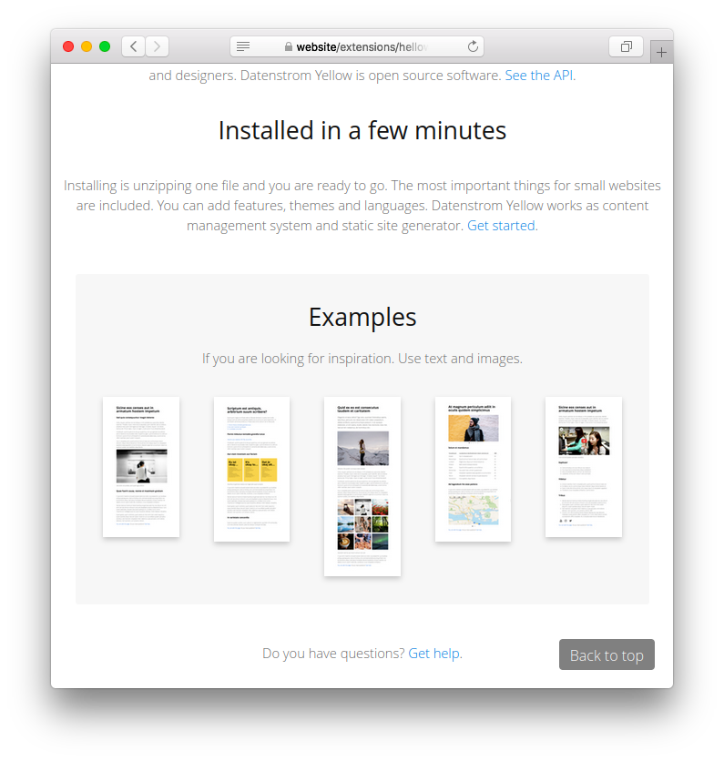

# Backtotop 1.0.0

Back-to-top link. Developed by Giovanni Salmeri.

## How to install an extension

[Download ZIP file](https://github.com/GiovanniSalmeri/yellow-backtotop/archive/refs/heads/main.zip) and copy it into your `system/extensions` folder. [Learn more about extensions](https://github.com/annaesvensson/yellow-update).

## How to add a Back-to-top link

This extension puts a back-to-top link on all pages of the site. The link is shown when the page is scrolled down.

If you want to customise the link with CSS, write a `backtotop.css` file and put it into your `system/themes` folder.

Do you have questions? [Get help](https://datenstrom.se/yellow/help/).
